<div align="center">

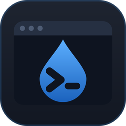

# TermDrop

**SSH, SFTP, Docker, MongoDB, Redis and remote desktops — one fast native app.**

A desktop client for the servers and datastores you look after, built with
[Tauri](https://tauri.app/) and Rust. Free and open source.

[](https://github.com/sevheng/TermDrop/releases/latest)
[](https://github.com/sevheng/TermDrop/actions/workflows/ci.yml)
[](LICENSE)


[**Download**](#download) · [Features](#features) · [Build from source](#build-from-source) · [Contributing](#contributing)

<br>

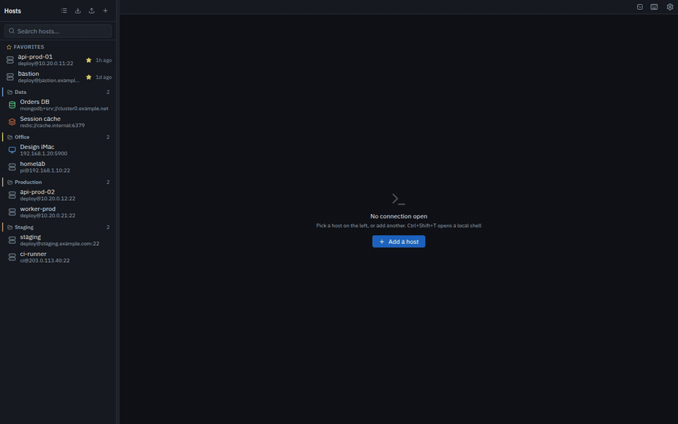

</div>

---

## Why TermDrop

Most days on a server mean juggling a terminal, an SFTP client, a database GUI,
a Redis browser and a VNC viewer — each with its own host list, its own copy of
your credentials and no idea that the box is behind a bastion. TermDrop keeps
them in one window that knows your hosts, your jump hosts and your keys.

- **Native and light.** A Rust backend and the system webview, not a bundled browser.
- **Local-first.** No account, no cloud sync, no telemetry. Passwords live in your OS keyring.
- **Safe by default.** Host keys are verified before any password is sent, and datastore browsing is read-only.

## Features

<table>
<tr>
<td width="50%" valign="top">

### SSH terminal + SFTP

Multi-tab terminal with full colour, search and reconnect, with an SFTP browser
beside it for uploads, downloads and drag-and-drop. A live status bar shows
load, memory, disk and network for the host.

</td>
<td width="50%" valign="top">

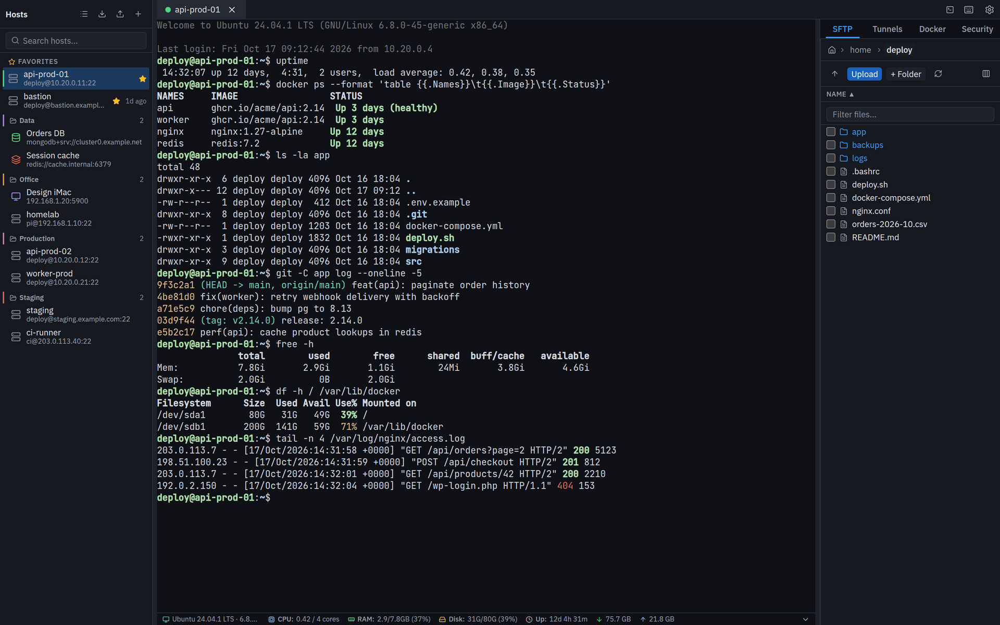

</td>
</tr>
<tr>
<td width="50%" valign="top">

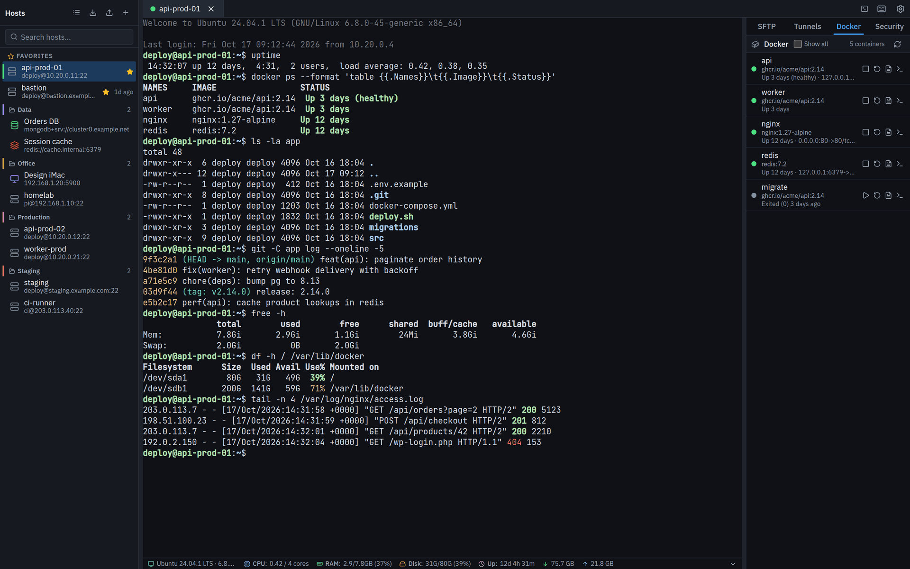

</td>
<td width="50%" valign="top">

### Docker, processes and a security audit

Start, stop and restart containers, follow their logs or open a shell in one.
Expand the status bar for processes, listening ports and disk usage. The
security audit checks a host for common misconfigurations and offers the
command to investigate each one.

</td>
</tr>
<tr>
<td width="50%" valign="top">

### MongoDB

Browse databases and collections, read documents as a table or as JSON with a
filter, sort and paging, and back up or restore collections with the bundled
MongoDB Database Tools — nothing to install.

</td>
<td width="50%" valign="top">

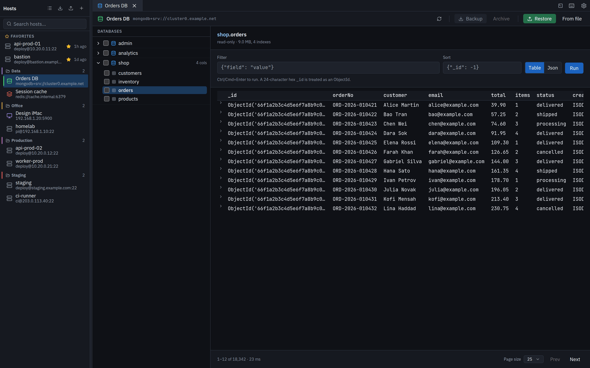

</td>
</tr>
<tr>
<td width="50%" valign="top">

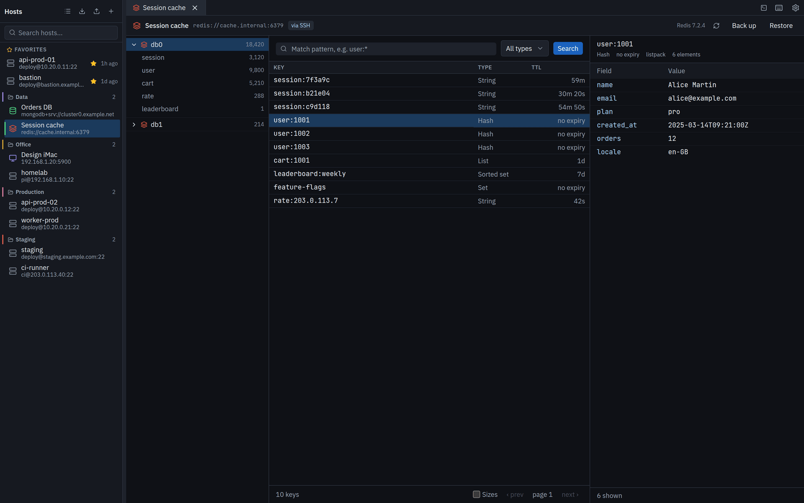

</td>
<td width="50%" valign="top">

### Redis

Keys grouped by prefix, type-aware viewers with TTL and encoding, and backup to
a portable file that works even on managed Redis. Every read is a bounded
`SCAN` — browsing can never stall a production server.

</td>
</tr>
</table>

<details>
<summary><b>More screenshots</b> — security audit, system panel, tunnels, light theme, local shells</summary>
<br>

| | |
|---|---|
| 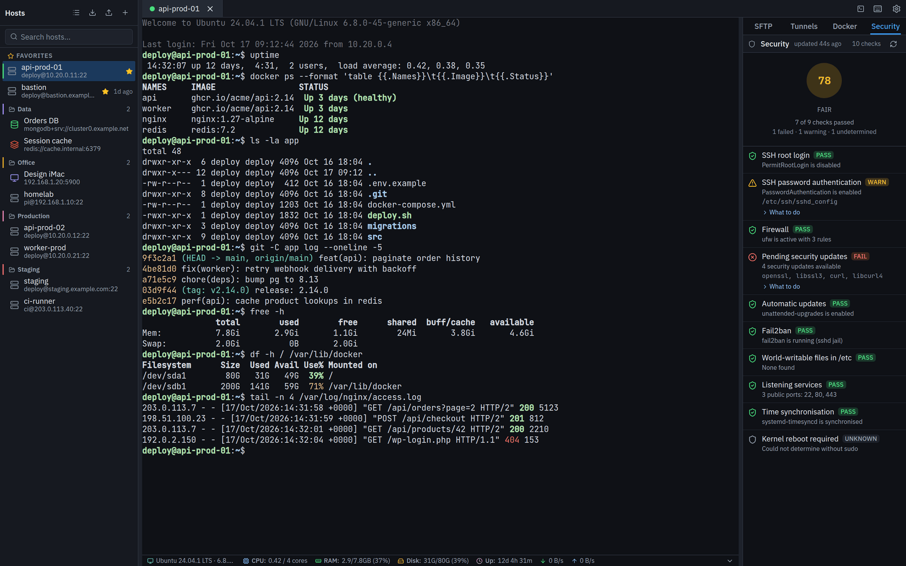 | 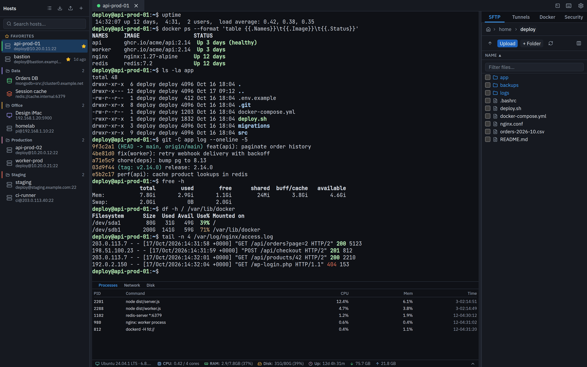 |
| **Security audit** — a score plus each check, with the command to dig in | **System panel** — processes, network and disk for the host |
| 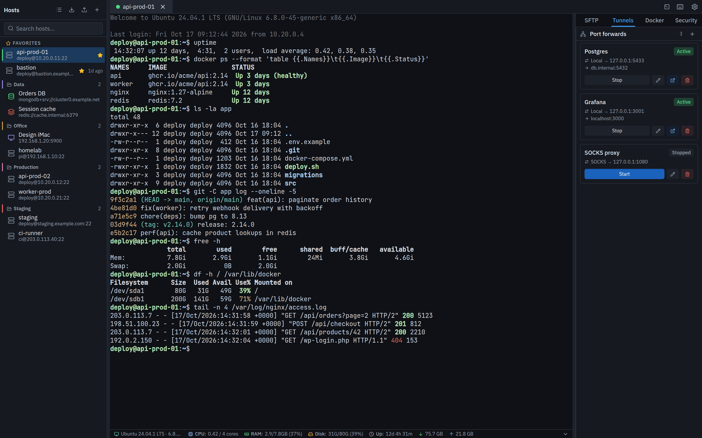 | 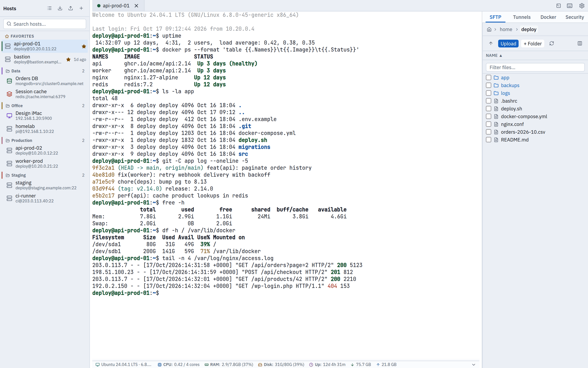 |
| **Port forwarding** — local forwards and a SOCKS proxy, per host | **Light theme** — the terminal follows the app |
| 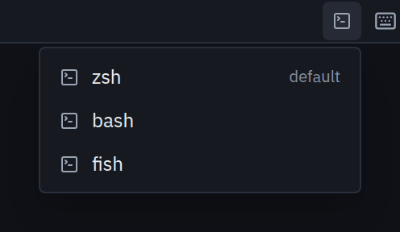 | 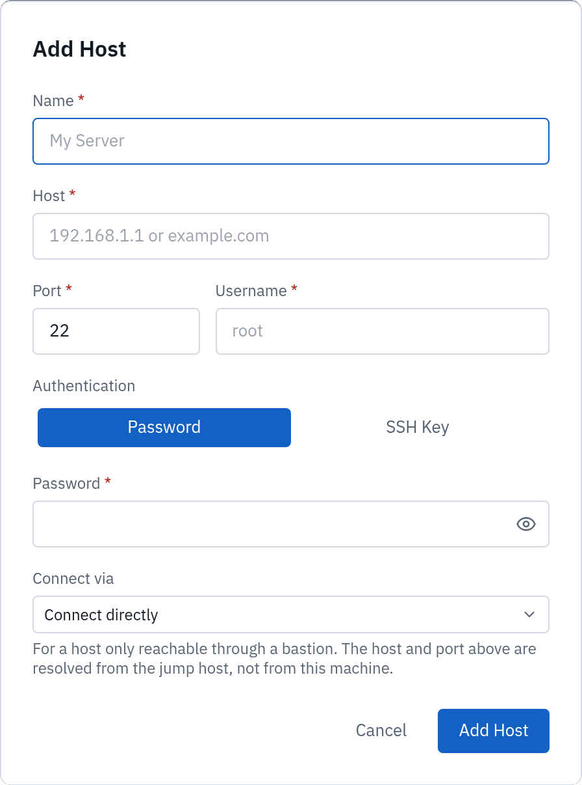 |
| **Local terminal** — your own shells and WSL distros, beside your servers | **Add a host** — password or key, optionally through a jump host |

</details>

### Everything it does

**Connect**
- Save SSH hosts, MongoDB and Redis connections and remote desktops, in groups and favourites, with search
- Password or SSH key authentication; import hosts from `~/.ssh/config` or a JSON export
- **Jump hosts** — reach servers behind a bastion, like OpenSSH's `ProxyJump`
- **Host key verification** before any credential is sent, honouring your `~/.ssh/known_hosts`

**Work on a server**
- Multi-tab xterm.js terminal: search, copy shortcuts, reconnect that keeps the tab and its SFTP session
- **Local terminal** (`Ctrl + Shift + T`) — zsh, bash, PowerShell, cmd, Git Bash or any WSL distro, beside your SSH tabs
- SFTP: browse, upload, download, rename, delete, create folders, drag-and-drop, transfer progress
- Docker: containers, start/stop/restart, logs and exec shells
- System stats, processes, ports and disk; a security audit with suggested commands
- Port forwarding: local forwards and a dynamic SOCKS proxy

**Datastores and desktops**
- **MongoDB** — browse (read-only), back up to a folder or archive, restore
- **Redis** — browse (read-only) with bounded `SCAN`s, binary-safe keys, backup and restore to `.tdredis`, optional SSH tunnel
- **Remote desktop** — VNC and macOS Screen Sharing in a tab, directly or through an SSH host

**Everyday**
- Light and dark themes; bundled IBM Plex Sans and JetBrains Mono so it looks the same everywhere
- Every text colour meets WCAG AA contrast; fully keyboard navigable
- Desktop notifications when a long backup or restore finishes
- Built-in updater

## Download

Grab the latest build from [**GitHub Releases**](https://github.com/sevheng/TermDrop/releases/latest).

| Platform | File | Requirements |
|----------|------|--------------|
| **Windows** | `TermDrop_<version>_x64_en-US.msi` | Windows 10 or 11, x64 |
| **macOS** | `TermDrop_<version>_aarch64.dmg` | macOS 11 Big Sur or later, Apple Silicon |
| **Linux** | `TermDrop_<version>_amd64.AppImage` or `.deb` | x86-64; built on Ubuntu 22.04 |

Updates are signed and offered from inside the app.

## Security and privacy

- Passwords never touch the local database: they go to the OS keyring, or to an AES-GCM encrypted file when no keyring is available
- Server host keys are checked before authentication; a changed key stops the connection
- Commands the security audit suggests are fixed strings, never built from server output, and are only typed at the prompt — you review them and press Enter yourself
- Host exports and backups carry no passwords
- No account, no cloud sync, no telemetry, no analytics

Found a vulnerability? Please report it privately — see [`SECURITY.md`](SECURITY.md).

## Build from source

**Prerequisites:** [Node.js](https://nodejs.org/) 24.15+ (see `.nvmrc`) and [Rust](https://rustup.rs/) stable. On Linux, Tauri also needs:

```bash
sudo apt install libwebkit2gtk-4.1-dev libappindicator3-dev librsvg2-dev patchelf
```

```bash
git clone https://github.com/sevheng/TermDrop.git
cd TermDrop
npm install
npm run tauri dev      # run with hot reload
npm run tauri build    # bundles to src-tauri/target/release/bundle/
```

The same checks CI runs on every push and pull request:

```bash
npm run lint && npm test
cd src-tauri && cargo fmt --check && cargo clippy --all-targets -- -D warnings && cargo test
```

<details>
<summary><b>Keyboard shortcuts</b></summary>
<br>

| Shortcut | Action |
|----------|--------|
| `Ctrl + Shift + T` | New local terminal |
| `Ctrl + Tab` / `Ctrl + PageDown` | Next tab |
| `Ctrl + Shift + Tab` / `Ctrl + PageUp` | Previous tab |
| `Ctrl + W` | Close the active tab |
| `Ctrl + F` | Find in the terminal |
| `Ctrl + Shift + C` / `Ctrl + Shift + A` | Copy selection / select all in the terminal |
| `↑` `↓` `Home` `End` `PageUp` `PageDown` | Move through the host list |
| `Enter` / `Delete` | Connect to / delete the focused host |
| `Ctrl/Cmd + Enter` | Run the query in a MongoDB collection |
| `Ctrl + Alt + Shift` | Release the keyboard from a remote desktop |
| `Ctrl + Shift + ?` | Show every shortcut |
| `Esc` | Close the find bar or the active dialog |

</details>

## Contributing

Bug reports, ideas and pull requests are welcome.

- Start with [`CONTRIBUTING.md`](CONTRIBUTING.md) for setup, project layout and conventions
- Use the [issue forms](https://github.com/sevheng/TermDrop/issues/new/choose) for bugs and feature requests
- This project follows the [Contributor Covenant](CODE_OF_CONDUCT.md)
- Release history is in [`CHANGELOG.md`](CHANGELOG.md)

## License

[MIT](LICENSE) © sevheng

<sub>Screenshots show the real interface with demo data; every hostname and address in them is fictional.</sub>
